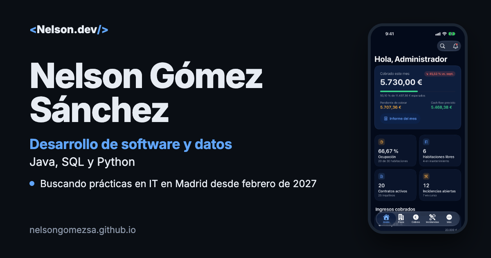

# nelsongomezsa.github.io

**Mi web personal: [nelsongomezsa.github.io](https://nelsongomezsa.github.io)**

Desarrollo de software y datos · Java, SQL y Python · Buscando prácticas en IT en Madrid desde febrero de 2027.



## Qué es

Una sola página con mis proyectos (GestionAp PRO, ChimiGO y Finance Tracker), experiencia, formación y CV en PDF. En español y en inglés (`?lang=en`).

## Stack

HTML, CSS y JavaScript sin frameworks ni dependencias. Fuentes alojadas en el propio repo (Inter y JetBrains Mono, licencia SIL OFL). Publicada con GitHub Pages.

- Lighthouse 100 en móvil (rendimiento, accesibilidad, buenas prácticas y SEO).
- Contraste AA, navegación con teclado y respeto a `prefers-reduced-motion`.
- Metadatos Open Graph, Twitter card y JSON-LD.

## Cómo verla en local

```bash
python3 -m http.server 8000
# y abre http://localhost:8000
```

## Autor

**Nelson Gómez Sánchez** · [LinkedIn](https://www.linkedin.com/in/nelson-g%C3%B3mez-s%C3%A1nchez/) · [nelsongomezsa@gmail.com](mailto:nelsongomezsa@gmail.com)
